# ClinicFlow — DevSecOps Final Capstone (Session 21)

**Raj Prakash** · Enrollment 24BCS10328 · [@RajPrakash681](https://github.com/RajPrakash681)

> **ClinicFlow** is a front-desk system for a small multi-doctor clinic. Reception staff book
> patients into a doctor's free slots, check them in when they arrive, and mark each visit
> completed, cancelled or a no-show, with every step written to an audit trail. The day schedule
> shows all doctors side by side; the dashboard tracks the waiting room, doctor utilisation and
> the 30-day no-show rate.
>
> The application domain is my own. This repository is a fork of the course's TaskBoard
> reference project ([Nency-Ravaliya/devsecops-python](https://github.com/Nency-Ravaliya/devsecops-python)):
> TaskBoard's code was replaced by ClinicFlow, and the DevOps layer follows the course
> architecture, which the rubric allows. The original course guide is kept in
> [`docs/course-taskboard-guide.md`](docs/course-taskboard-guide.md).

**Demo:** 🎥 [`demo/ClinicFlow-demo.mp4`](demo/ClinicFlow-demo.mp4) · 📊 [`demo/ClinicFlow-presentation.pptx`](demo/ClinicFlow-presentation.pptx) ([PDF](demo/ClinicFlow-presentation.pdf))

| | |
|---|---|
| **Frontend** | React 19 + Vite 8: day schedule grid, booking against free slots, check-in workflow, responsive down to phone width |
| **Backend** | FastAPI (Python 3.12), SQLAlchemy 2, Pydantic 2; 17 endpoints (14 under `/api`) |
| **Database** | PostgreSQL 17: 3 tables from 3 Alembic migrations, CHECK constraints, migrations serialised by an advisory lock |
| **Tests** | 32 pytest cases on a throwaway SQLite database built by the real migrations (92% coverage); migrations also tested up/down/up and under a three-replica race on real PostgreSQL in CI |
| **CI/CD** | GitHub Actions, 11 jobs: test → scan → build → push to **GHCR tagged with the commit SHA** → Helm deploy + smoke test → **GitOps promotion** |
| **Security** | Trivy gate on both images (fixable HIGH/CRITICAL fails the build), Gitleaks over the whole Git history, Bandit, `npm audit`, non-root read-only containers, restricted Pod Security |
| **Kubernetes** | Helm chart: backend + frontend Deployments (2 replicas each), PostgreSQL StatefulSet + PVC, ClusterIP Services, Ingress, HPA 2–6, PDBs |
| **GitOps** | Argo CD watches `main` and syncs the cluster to the SHA the pipeline promoted (auto-sync, prune, self-heal) |
| **Observability** | `/metrics` with clinic business metrics, ServiceMonitor, 7 alert rules, a 19-panel Grafana dashboard shipped as code |
| **Infrastructure** | Terraform: AWS VPC (2 public + 2 private subnets, NAT), EKS 1.34 + managed node group in `ap-south-1`, 23 resources. Run against the moto AWS emulator, not a real account; see [§12](#12-m7--terraform-aws-vpc--eks) |

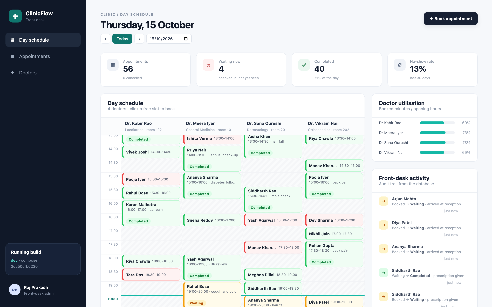

---

## Contents

1. [What ClinicFlow does](#1-what-clinicflow-does)
2. [Architecture](#2-architecture)
3. [Tech stack](#3-tech-stack)
4. [Repository structure](#4-repository-structure)
5. [Run it locally](#5-run-it-locally)
6. [M1 — Application](#6-m1--application)
7. [M2 — Testing](#7-m2--testing)
8. [M3 — Git and GitHub](#8-m3--git-and-github)
9. [M4 — Docker](#9-m4--docker)
10. [M5 — CI/CD](#10-m5--cicd-github-actions)
11. [M6 — DevSecOps](#11-m6--devsecops-trivy)
12. [M7 — Terraform](#12-m7--terraform-aws-vpc--eks)
13. [M8 — Kubernetes, Helm and GitOps](#13-m8--kubernetes-helm-and-gitops)
14. [M9 — Observability](#14-m9--observability-prometheus--grafana)
15. [Troubleshooting labs](#15-troubleshooting-labs)
16. [Engineering findings](#16-engineering-findings)
17. [Known issues and limitations](#17-known-issues-and-limitations)
18. [M10 — Presentation and demo](#18-m10--presentation-and-demo)
19. [Submission checklist](#19-submission-checklist)

---

## 1. What ClinicFlow does

- **Doctors:** name, specialty, room. A doctor can go "on leave" (stops taking bookings). A doctor
  with appointment history can't be deleted, only deactivated (foreign key `ON DELETE RESTRICT`).
- **Booking without double-booking:** a new appointment locks the doctor's row
  (`SELECT … FOR UPDATE`) and is rejected with **409** if it overlaps another active appointment.
  Two backend replicas booking the same doctor at the same moment queue on that lock, so neither
  can miss the other's insert. Opening hours (08:00–21:00, morning and evening OPD) are enforced
  with **422**.
- **Free slots:** `GET /api/doctors/{id}/slots?date=` returns the doctor's day in 30-minute steps;
  the booking form only offers free ones.
- **Front-desk workflow:** `BOOKED → CHECKED_IN → COMPLETED`, or `CANCELLED` / `NO_SHOW`. Any other
  transition is a **409** naming the allowed moves. Every booking, reschedule and status change is
  written to `appointment_events`, the audit trail behind the activity feed.
- **Daily KPIs:** appointments by status, patients waiting now, utilisation per doctor (booked
  minutes / opening minutes), and the 30-day no-show rate.

| Method | Endpoint | Purpose |
|---|---|---|
| GET | `/health` | liveness: process up, no DB call |
| GET | `/ready` | readiness: DB reachable **and** schema migrated, else `503` |
| GET | `/metrics` | Prometheus metrics (not routed through the Ingress) |
| GET | `/api/info` | build version, environment, answering pod, clinic hours |
| GET | `/api/doctors` | list (`?active=`) |
| POST | `/api/doctors` | add a doctor (`422` invalid) |
| PUT | `/api/doctors/{id}` | update / put on leave |
| DELETE | `/api/doctors/{id}` | delete (`409` if it has appointment history) |
| GET | `/api/doctors/{id}/slots` | free/busy slots for one day |
| GET | `/api/appointments` | list (`?date=`, `?doctor_id=`, `?status=`, `?q=` name or phone) |
| GET | `/api/appointments/{id}` | one appointment (`404`) |
| POST | `/api/appointments` | book (`409` overlap or doctor on leave, `422` outside hours / invalid) |
| PUT | `/api/appointments/{id}` | reschedule or correct details (`409` unless still BOOKED, `409` overlap) |
| DELETE | `/api/appointments/{id}` | remove a booking made in error (events cascade) |
| POST | `/api/appointments/{id}/status` | workflow transition with a note (`409` illegal move) |
| GET | `/api/events` | audit trail, newest first (`?limit=` 1–100) |
| GET | `/api/stats` | KPIs for a day (`?date=`, default today in the clinic's time zone) |

Swagger UI: `/docs` (also through the Ingress).

---

## 2. Architecture

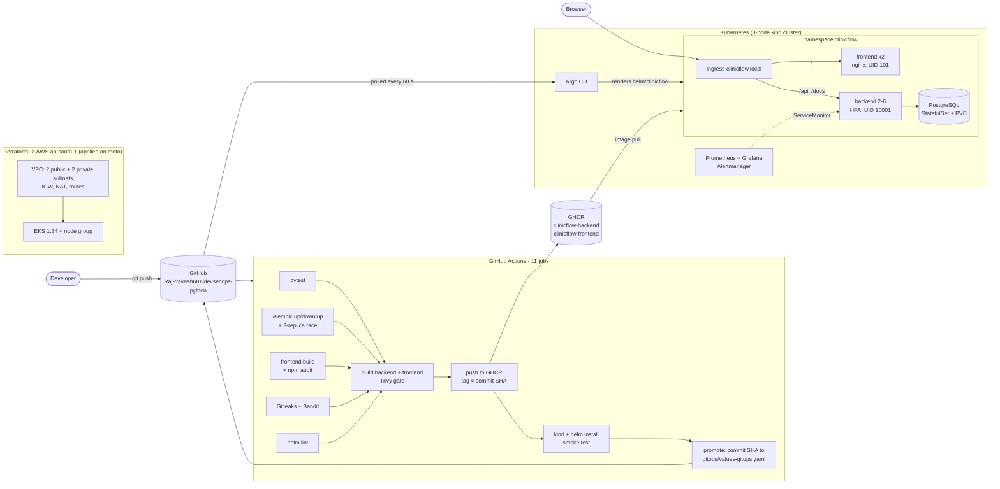

- **One hostname.** The Ingress sends `/api`, `/docs` and `/openapi.json` to the backend and
  everything else to the frontend, so the browser never needs the backend's address. In Docker
  Compose, the frontend's nginx proxies `/api` instead; the same image works in both.
- **Nobody runs `kubectl apply` for production.** The pipeline writes the tested image SHA into
  Git, and Argo CD makes the cluster match Git.
- **Staging** (`clinicflow-staging`) is installed by hand with `helm upgrade --install`, which is
  how the rubric's Helm steps are shown ([§13](#13-m8--kubernetes-helm-and-gitops)).

---

## 3. Tech stack

| Layer | Tools (versions as used) |
|---|---|
| Languages | Python 3.12, JavaScript (React 19 JSX), HCL, YAML, Bash |
| Backend | FastAPI 0.143, SQLAlchemy 2.1, Alembic 1.20, Pydantic 2.14, psycopg 3, uvicorn |
| Frontend | React 19, Vite 8, nginx-unprivileged 1.31 (Alpine) |
| Database | PostgreSQL 17 |
| Testing | pytest 9, pytest-cov, FastAPI TestClient (httpx2), SQLite for tests |
| Containers | Docker, Docker Compose, multi-stage builds |
| CI/CD | GitHub Actions, GitHub Container Registry, kind (`helm/kind-action`) |
| Security | Trivy 0.75, Gitleaks 8.30, Bandit 1.9, npm audit, Pod Security Admission (restricted) |
| Infrastructure | Terraform 1.16, AWS provider 6.69; moto 5.1 as the AWS endpoint ([§12](#12-m7--terraform-aws-vpc--eks)) |
| Kubernetes | kind (3 nodes, Kubernetes 1.34), Helm 3.22, ingress-nginx, metrics-server |
| GitOps | Argo CD 3.5 (argo-cd chart 10.10.5) |
| Observability | kube-prometheus-stack 92.8 (Prometheus, Alertmanager, Grafana, kube-state-metrics, node-exporter), prometheus-fastapi-instrumentator |
| Platform | macOS (Apple Silicon), Docker Desktop; GitHub-hosted `ubuntu-24.04` runners |

---

## 4. Repository structure

```text
devsecops-python/
├── backend/                       FastAPI application
│   ├── app/                       main.py (routes), models.py, schemas.py, db.py, config.py,
│   │                              metrics.py (business metrics), wait_for_db.py
│   ├── alembic/versions/          0001_create_doctors, 0002_create_appointments, 0003_create_appointment_events
│   ├── tests/                     conftest.py (SQLite DB built by the migrations) + test_api.py (32 cases)
│   ├── pytest.ini, requirements.txt, requirements-dev.txt, Dockerfile, docker-entrypoint.sh
├── frontend/                      React app, nginx config template, multi-stage Dockerfile
│   └── src/                       App.jsx, api.js, components/ (ScheduleGrid, BookingModal, ...)
├── docker-compose.yml             postgres + backend + frontend
├── .github/workflows/ci-cd.yml    the pipeline (11 jobs)
├── helm/clinicflow/               chart: values.yaml, values-dev/-staging/-prod.yaml, templates/, dashboards/
├── k8s/namespace.yaml             namespaces (production + staging), restricted Pod Security
├── gitops/                        Argo CD Application, Argo CD install values, values-gitops.yaml (written by CI)
├── monitoring/                    kube-prometheus-stack values + how the app plugs in
├── terraform/                     AWS VPC + EKS: versions.tf, variables.tf, main.tf, outputs.tf,
│   │                              terraform.tfvars.example, .terraform.lock.hcl
│   └── emulator/                  run.sh + provider override for the moto emulator, aws.sh
├── security/                      trivy.yaml, .gitleaks.toml, bandit.yaml
├── troubleshooting/               lab1-broken-image, lab2-broken-service, lab3-broken-probe
├── scripts/                       seed.py/seed.sh (demo clinic), load-test.sh, hpa-watch.sh, migration-race-job.yaml
├── screenshots/                   every screenshot referenced below
├── demo/                          presentation video (MP4) + slide deck (PPTX, PDF)
└── docs/                          the course's original TaskBoard guide and Terraform lab
```

---

## 5. Run it locally

```bash
docker compose up --build        # http://localhost:3000  ·  API docs http://localhost:8000/docs
python3 scripts/seed.py          # four doctors, two weeks of history, today and tomorrow
docker compose down              # stop (add -v to delete the database volume too)
```

The Compose default database password is a local-only value; put `POSTGRES_PASSWORD=...` in a
`.env` file (see [`.env.example`](.env.example)) to override it.

Backend on its own:

```bash
cd backend
python3.12 -m venv .venv && source .venv/bin/activate
pip install -r requirements-dev.txt
python -m pytest -v                                           # no database needed
export DATABASE_URL='postgresql+psycopg://clinicflow:<password>@localhost:5432/clinicflow'
alembic upgrade head
uvicorn app.main:app --reload --port 8000
```

Frontend dev server (proxies `/api` to `localhost:8000`): `cd frontend && npm install && npm run dev`.

---

## 6. M1 — Application

**Backend** ([`backend/app/`](backend/app/)): FastAPI with Pydantic validation (phone pattern, name
lengths, 10–120-minute durations, status enum), SQLAlchemy 2 models, the 17 endpoints in §1.
Timestamps sent with a UTC offset are converted to the clinic's time zone (`CLINIC_TZ`,
default `Asia/Kolkata`) before they are stored; there's a test for it.

**Database** ([`backend/alembic/versions/`](backend/alembic/versions/)): three migrations
(`doctors`, `appointments` with `CHECK (ends_at > starts_at)` and a status `CHECK`,
`appointment_events` with `ON DELETE CASCADE`). Each backend container runs `alembic upgrade head`
before it serves. A Postgres **advisory lock** in [`alembic/env.py`](backend/alembic/env.py) makes
concurrent replicas take turns ([§13](#13-m8--kubernetes-helm-and-gitops) shows the race test).

**Frontend** ([`frontend/src/`](frontend/src/)): built on the course's TaskBoard layout and
restyled. Every panel reads live data from the API, and the opening hours come from `/api/info`,
so the UI can't offer a slot the backend would reject. It has loading and backend-error states.
Below 760 px wide, the sidebar becomes a top bar, the schedule grid becomes an agenda list, and
table rows become cards.

| Booking only offers the doctor's free slots | Appointments list with workflow actions |
|---|---|
| 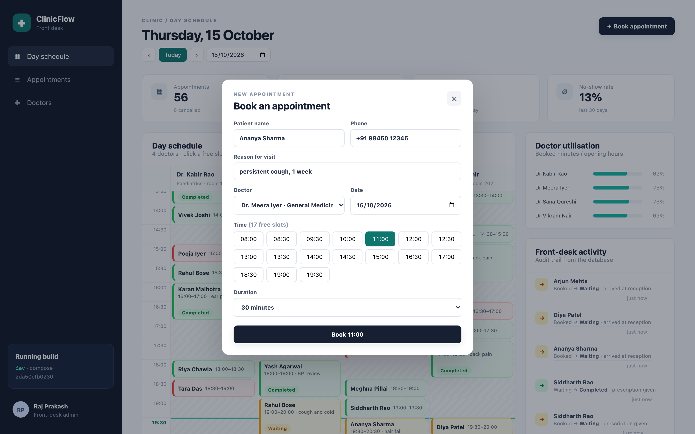 | 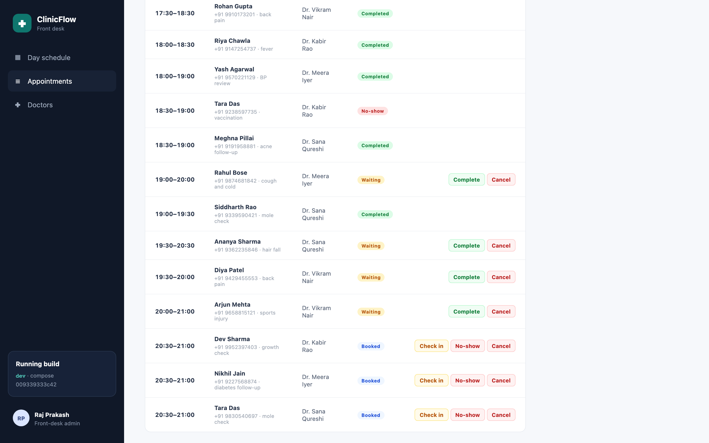 |

| Phone (390 px) | Swagger UI |
|---|---|
| 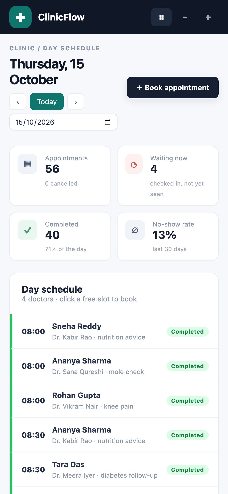 | 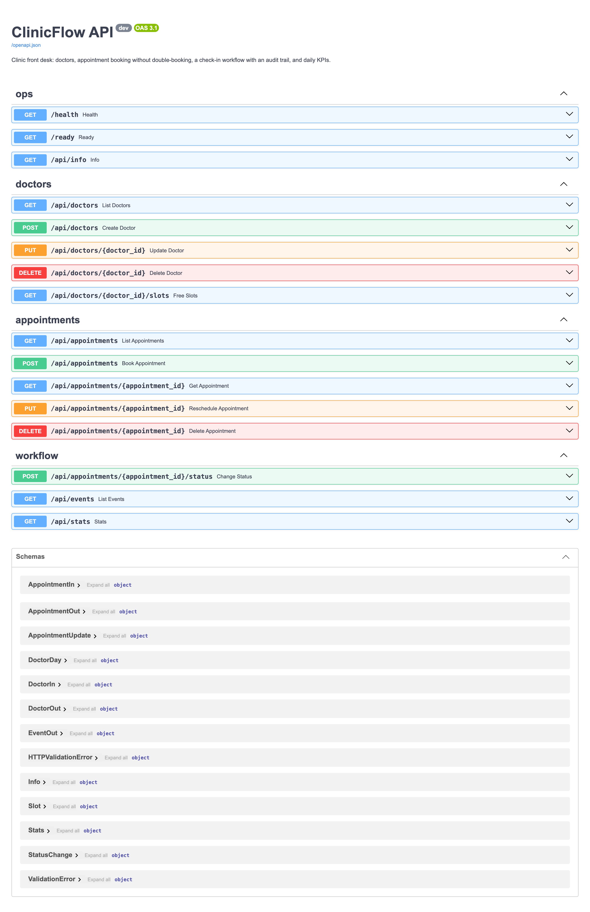 |

---

## 7. M2 — Testing

```bash
cd backend && python -m pytest -v --cov=app
```

- **32 test cases** (26 functions, some parametrised) cover every route: ops, doctors, booking,
  overlaps and back-to-back bookings, opening hours, validation, time zones, filters, free slots,
  reschedule, delete cascade, every workflow transition (legal and illegal), stats, the no-show
  rate, and the metrics output (including the 5 ms latency bucket). Coverage is 92%.
- **Never the production database.** [`tests/conftest.py`](backend/tests/conftest.py) sets
  `DATABASE_URL` to a throwaway **SQLite** file *before* the app is imported, then builds the
  schema by running the **real Alembic migrations**, so the migration files are tested too. Each
  test starts from empty tables. [`pytest.ini`](backend/pytest.ini) configures discovery.
- In CI a second job runs the migrations on **real PostgreSQL 17**: `upgrade → downgrade → upgrade`
  (every migration is reversible), then three `alembic upgrade head` processes at once against an
  empty database, asserting that exactly one did the work and all three exited 0.

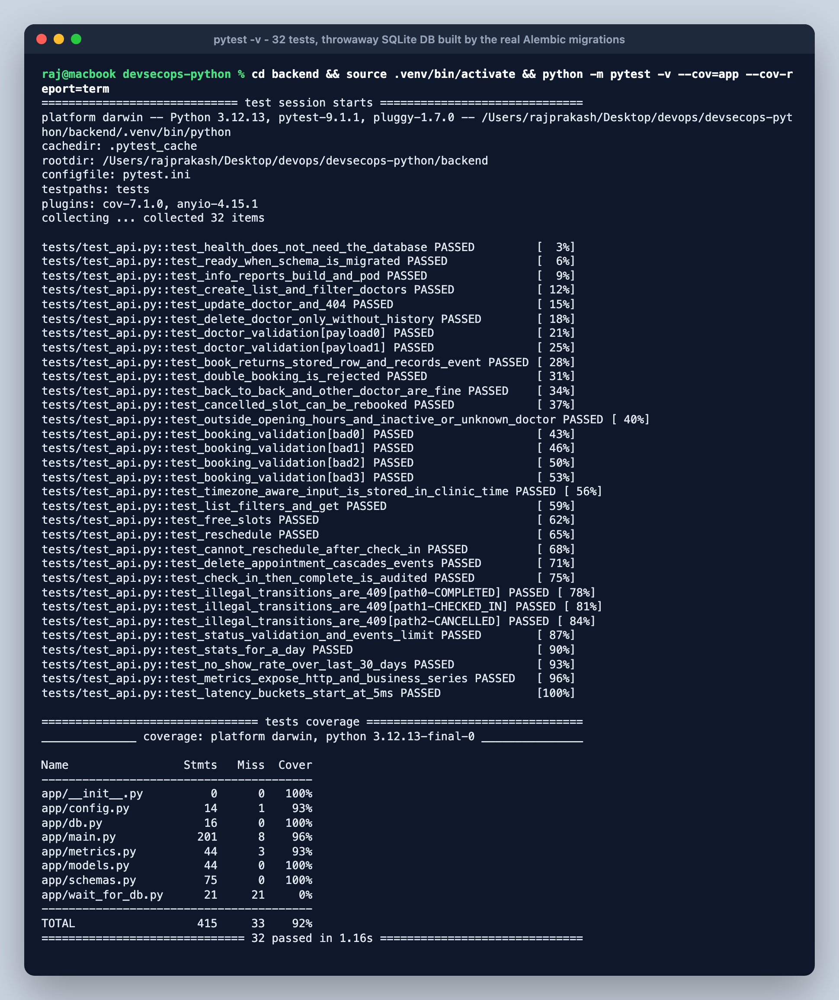

---

## 8. M3 — Git and GitHub

- Public repository: <https://github.com/RajPrakash681/devsecops-python>, a fork of the course
  repository (its history is kept below mine).
- One commit per logical change, each message saying what changed and why: the backend, frontend,
  compose, Helm, monitoring, GitOps, security, Terraform and pipeline, then the fixes found while
  running it. The `gitops: deploy clinicflow <sha>` commits are made by the pipeline itself.
- [`.gitignore`](.gitignore) excludes `.env` / `.env.*`, `__pycache__/`, `node_modules/`, `.venv/`,
  build output, `*.tfvars`, Terraform state and plan files.

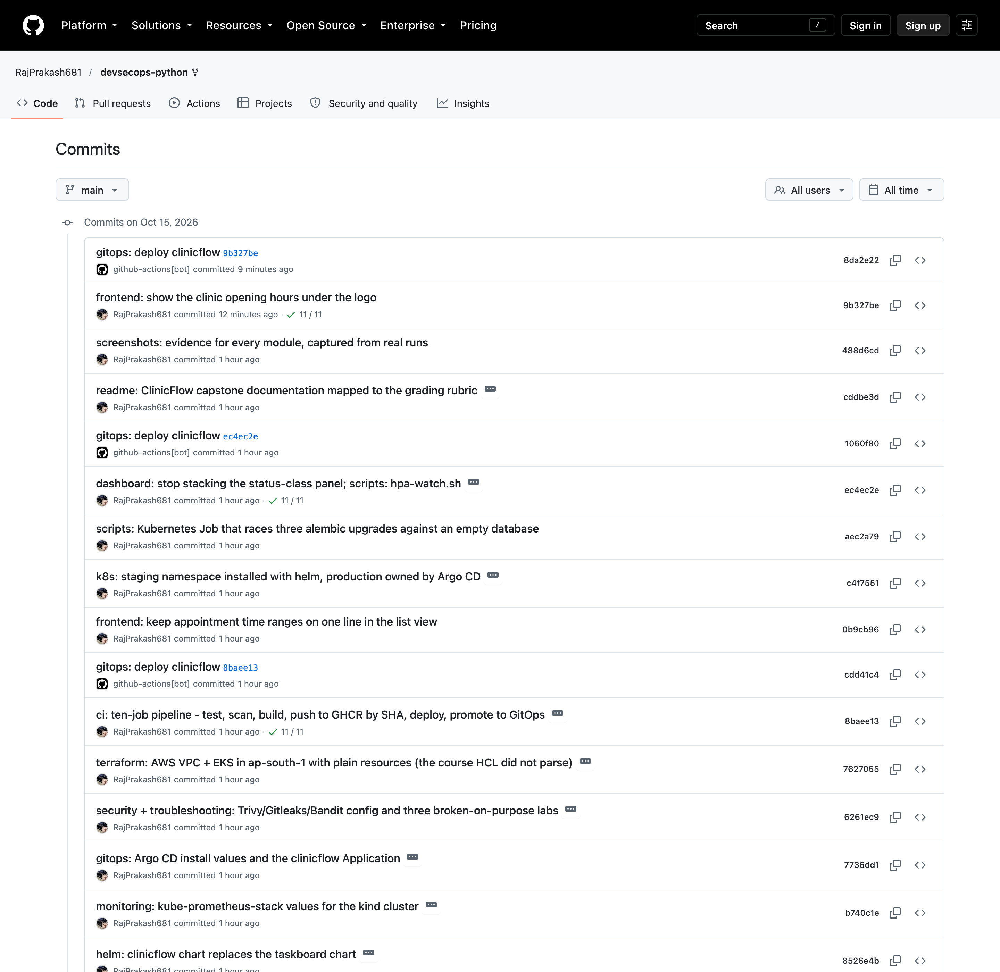

---

## 9. M4 — Docker

| Image | Build | Runtime | User |
|---|---|---|---|
| **backend** ([Dockerfile](backend/Dockerfile)) | `python:3.12-slim`; dependencies in their own cached layer | [`docker-entrypoint.sh`](backend/docker-entrypoint.sh): wait for the DB → `alembic upgrade head` → `uvicorn` | **UID 10001** |
| **frontend** ([Dockerfile](frontend/Dockerfile)) | **multi-stage**: `node:22-alpine` runs `npm ci && npm run build` | `nginx-unprivileged:1.31-alpine` serving only `dist/`; no Node, no source; unused nginx modules removed ([§11](#11-m6--devsecops-trivy)) | **UID 101** |

[`docker-compose.yml`](docker-compose.yml) starts the three services in order: postgres must be
*healthy* before the backend starts, and the backend's `/ready` must pass before the frontend
starts.

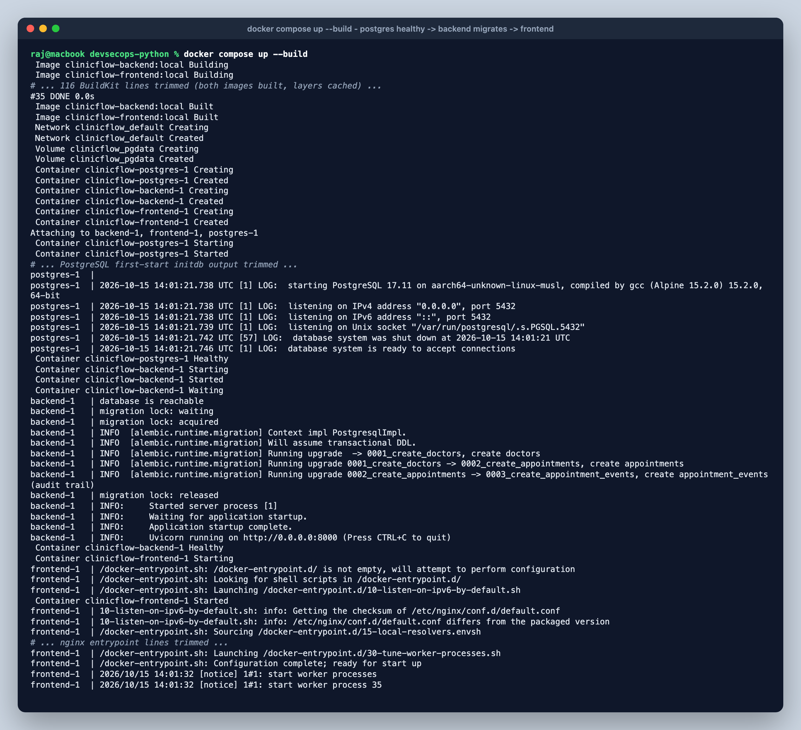

The running stack at <http://localhost:3000> is the hero image at the top of this README. Below:
CRUD over HTTP, a rejected double booking, the tables Alembic created, and both containers
running as non-root:

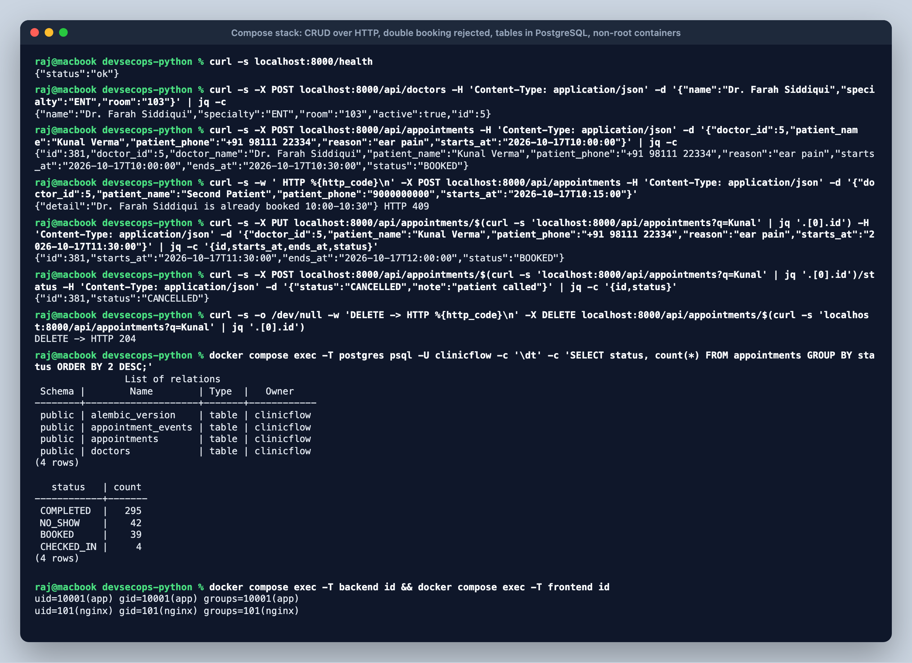

---

## 10. M5 — CI/CD (GitHub Actions)

Workflow: [`.github/workflows/ci-cd.yml`](.github/workflows/ci-cd.yml). It runs on every push to
`main` (Markdown, screenshots, `demo/` and the GitOps values file excepted), on pull requests,
and on demand.

| Job | What it does |
|---|---|
| Backend tests (pytest) | `pytest -v --cov`; **any failure stops the pipeline**, so no image is built from broken code |
| Alembic migrations on PostgreSQL | up/down/up plus the three-replica race against a Postgres 17 service container |
| Frontend build | `npm ci`, `npm run build`, `npm audit --omit=dev --audit-level=high` |
| Secret scan + SAST | Gitleaks over the **full Git history**, Bandit (medium+ fails) |
| Helm chart lint | `helm lint` + `helm template` for default, dev, prod and GitOps values |
| Build + Trivy scan ×2 | builds **both** images and scans each; a fixable HIGH/CRITICAL fails the job |
| Push to GHCR ×2 | pushes **the exact image that was scanned** (saved as an artifact, never rebuilt) |
| Deploy with Helm + smoke test | kind → `helm upgrade --install` from GHCR → checks `/api/info` reports this commit, books an appointment (201), books it again (409) |
| Promote to GitOps | commits the SHA into `gitops/values-gitops.yaml`; Argo CD deploys it |

**Image tags are the full commit SHA, never `latest`**, so every image traces back to the commit
that built it. Pushes use the job's short-lived `GITHUB_TOKEN`; no registry password is stored
anywhere. The course workflow this replaces pushed `latest` to Docker Hub and rebuilt the images
between the scan and the push, so the image that was pushed was never the one that was scanned.

| Run | Commit | Result |
|---|---|---|
| [#1](https://github.com/RajPrakash681/devsecops-python/actions/runs/38745731599) | `8baee13` | ✅ 11/11 jobs, 3m 1s, first run |
| [#2](https://github.com/RajPrakash681/devsecops-python/actions/runs/38751588093) | `ec4ec2e` | ✅ 11/11 jobs, 3m 26s; Argo CD deployed it automatically |
| [#3](https://github.com/RajPrakash681/devsecops-python/actions/runs/38760376972) | `9b327be` | ✅ 11/11 jobs, 3m 23s: the change pushed live in the demo video (opening hours under the logo), deployed by Argo CD |

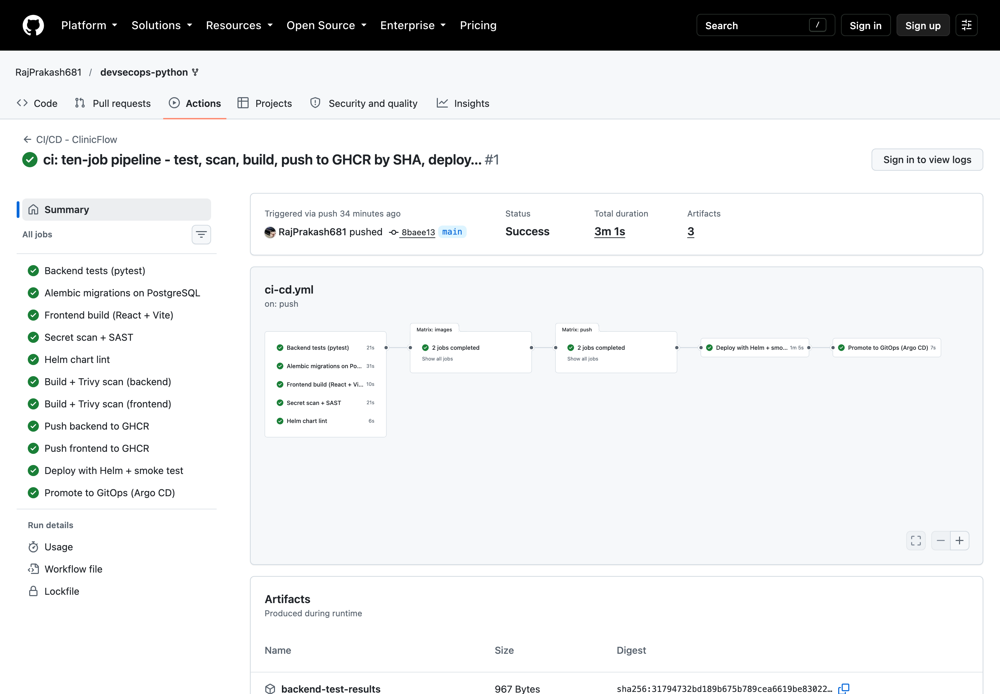

Published images (public): [clinicflow-backend](https://github.com/RajPrakash681/devsecops-python/pkgs/container/clinicflow-backend)
and [clinicflow-frontend](https://github.com/RajPrakash681/devsecops-python/pkgs/container/clinicflow-frontend),
one SHA tag per pipeline run (three runs, three tags, no `latest`):

| Backend | Frontend |
|---|---|
|  | 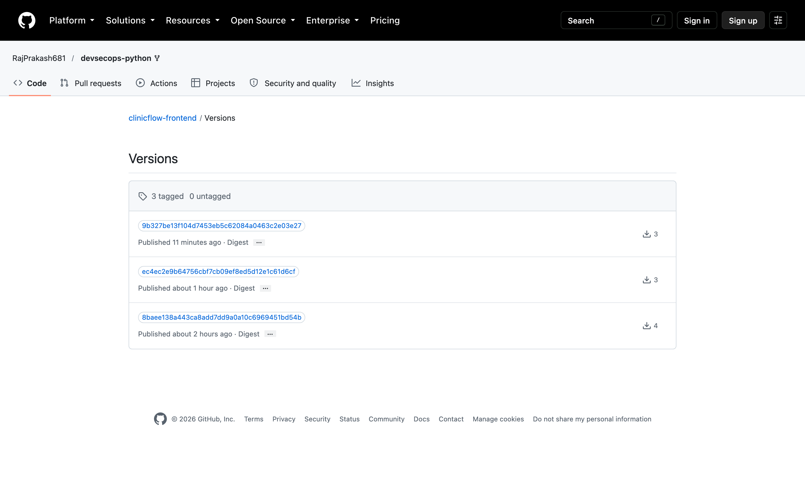 |

---

## 11. M6 — DevSecOps (Trivy)

[`security/trivy.yaml`](security/trivy.yaml) sets the gate: `severity: [HIGH, CRITICAL]`,
`exit-code: 1`, `vulnerability.ignore-unfixed: true`, and the secret scanner on.

**What Trivy scanned and what the result means.** Trivy inspected every OS package in both images
(87 Debian packages in the backend, 31 Alpine packages in the frontend) and every Python package
installed in the backend, and compared them with its vulnerability database. The pipeline result
is **0 fixable HIGH or CRITICAL vulnerabilities in either image**, so the gate let both images
through to GHCR. The gate only fails on findings that have a fix: blocking on vulnerabilities
nobody can patch yet would stop every build without making anything safer.

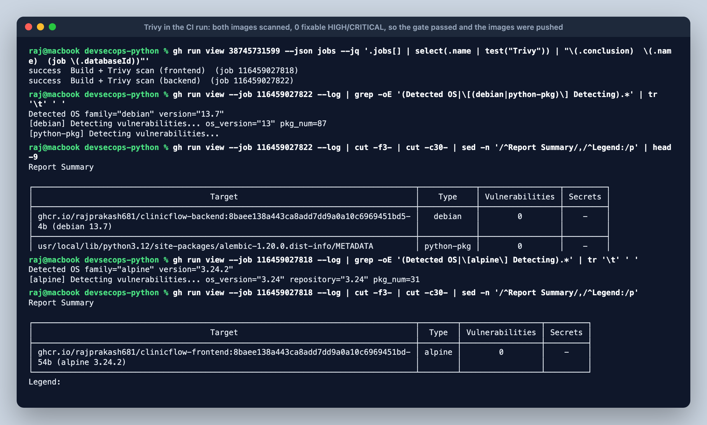

**One CVE it found, explained.** The first frontend image failed the gate on **CVE-2026-4775**,
a HIGH-severity bug in **libtiff** 4.7.1. A crafted TIFF file can trigger a signed-integer error
that leads to code execution or denial of service; 4.7.2 fixes it. ClinicFlow never touches TIFF
files: libtiff was in the image only because the nginx base image ships the `image-filter` module
(→ libgd → libtiff). The fix removes the dynamic modules ClinicFlow never loads (image-filter,
xslt, geoip, njs), which took the frontend from 70 to 31 packages, instead of only upgrading
libtiff. Below, the same scan on the unpatched image exits **1**; the fixed image exits **0**:

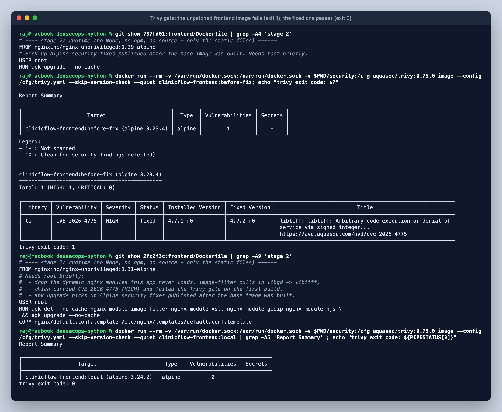

Other layers:
- **Gitleaks** scans the whole history; the allowlist covers only the documented demo values.
- **Bandit** (Python SAST) and **`npm audit`** (frontend dependencies).
- Runtime hardening in the chart: non-root, read-only root filesystem, all capabilities dropped,
  `RuntimeDefault` seccomp.
- Both namespaces enforce the **restricted** Pod Security Standard, so a pod that asks for root is
  refused at admission.

---

## 12. M7 — Terraform (AWS VPC + EKS)

> **Honest scope.** I don't have an AWS account, so this module ran against **moto**, an AWS API
> emulator, in Docker. The Terraform code, the plan, the 23 resources, the apply, the state and
> the destroy are all real Terraform; the AWS endpoint is local. That means **there is no AWS
> Console screenshot**. In its place, the real AWS CLI queries the emulated account. Nothing was
> created or billed in a real AWS account. The same code runs on real AWS unchanged; the steps are
> below.

[`terraform/`](terraform/) provisions, in **`ap-south-1`**, with plain resources rather than
community modules, so every object in the plan is visible in [`main.tf`](terraform/main.tf).
The course's own Terraform didn't parse: whole blocks were written on one line.

| Resource | Details |
|---|---|
| VPC | `10.21.0.0/16`, DNS hostnames on (EKS nodes need them) |
| Public subnets ×2 | 2 AZs, public IPs on launch, tagged `kubernetes.io/role/elb` |
| Private subnets ×2 | worker nodes; outbound through NAT; tagged `kubernetes.io/role/internal-elb` |
| IGW, NAT gateway + Elastic IP, 2 route tables, 4 associations | public → IGW, private → NAT (`enable_nat_gateway`) |
| IAM | cluster role (`AmazonEKSClusterPolicy`); node role (worker, CNI, ECR read-only) |
| **EKS 1.34** | public + private endpoint, public access limited by `api_allowed_cidrs`, creator gets cluster admin |
| **Managed node group** | `t3.medium` × 2 (min 1, max 3), on-demand, in the **private** subnets |

**On real AWS:**

```bash
cd terraform
cp terraform.tfvars.example terraform.tfvars        # owner, your IP in api_allowed_cidrs
aws configure                                       # credentials stay outside the repo
terraform init && terraform plan -out=tfplan && terraform apply tfplan
aws eks update-kubeconfig --region ap-south-1 --name clinicflow-eks
terraform destroy                                   # always, right after the evaluation
```

**What I ran (moto):** [`terraform/emulator/run.sh`](terraform/emulator/run.sh) starts moto,
copies in a provider override (`*_override.tf`, git-ignored, deleted on exit) that points the AWS
endpoints at `localhost:5050` with dummy credentials, and passes its arguments to `terraform`.

**`terraform init`, `validate`, `plan`:** 23 to add, 0 to change, 0 to destroy.

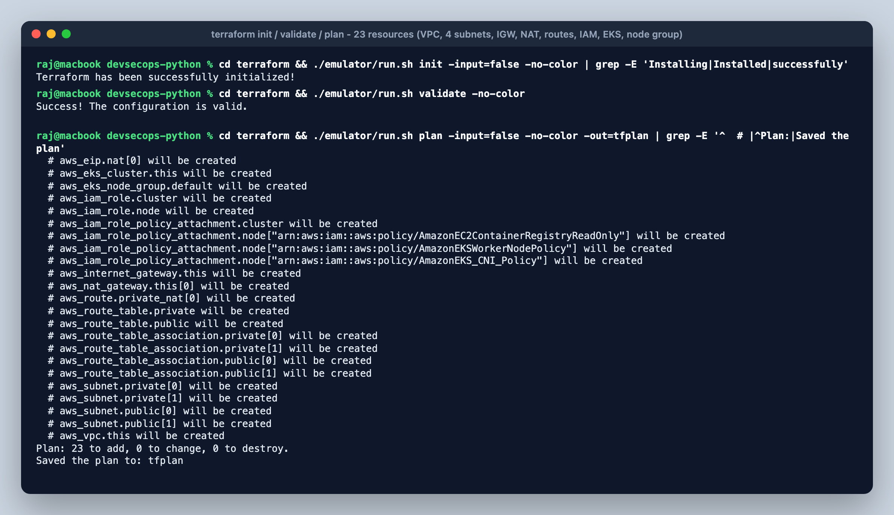

**`terraform apply` and the outputs:**

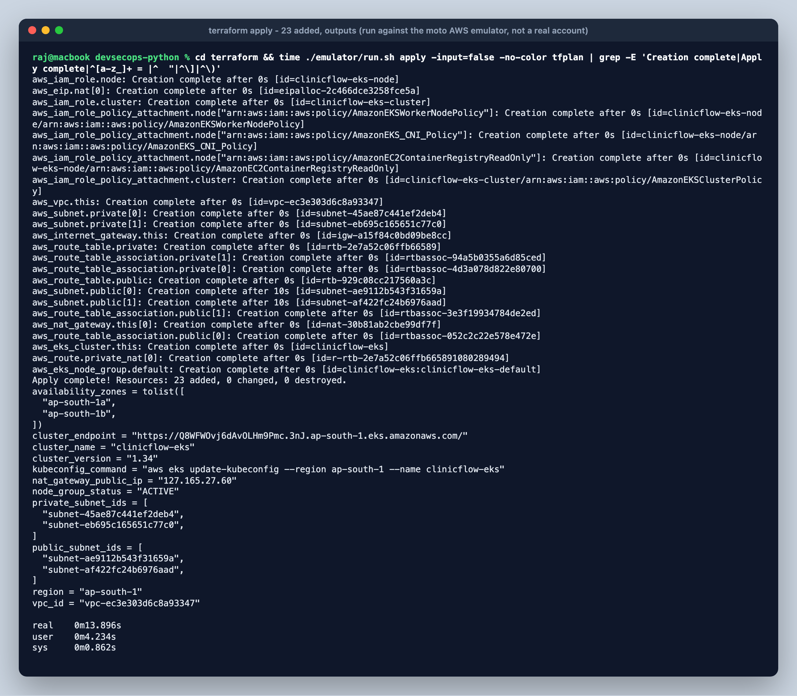

**Inventory instead of the Console.** These come from the real AWS CLI
([`emulator/aws.sh`](terraform/emulator/aws.sh)) querying the emulated account: the VPC, four
subnets in two AZs (public ones map public IPs), the NAT gateway in a public subnet, and the two
route tables (public → IGW, private → NAT).

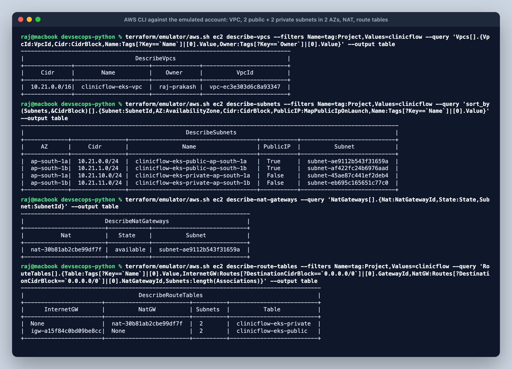

The EKS cluster `ACTIVE` on 1.34 across 4 subnets, and the managed node group (t3.medium, 1/2/3)
in the two private subnets with its three IAM policies:

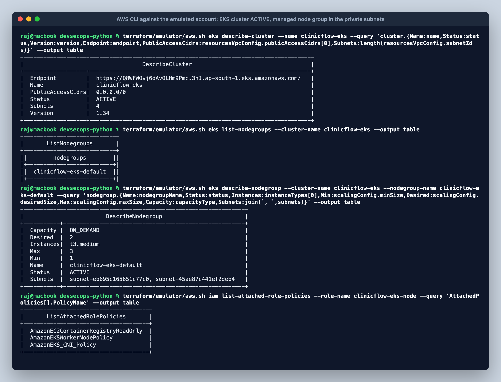

**`terraform destroy`:** 23 destroyed, then checked: state empty, no tagged VPC, no cluster, NAT
gateway deleted, no Elastic IP left.

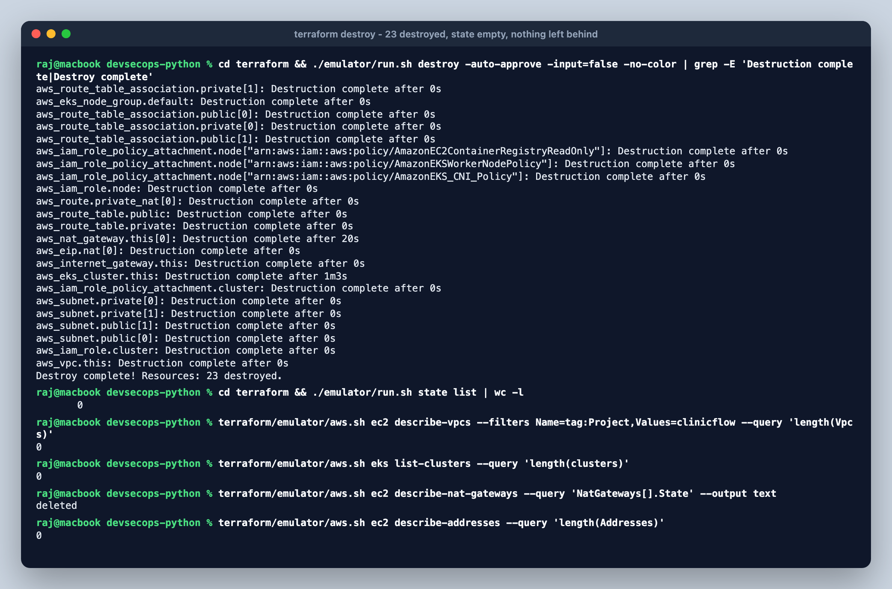

- **No credentials in Git:** only [`terraform.tfvars.example`](terraform/terraform.tfvars.example)
  is committed; `*.tfvars`, state and plans are ignored, and Gitleaks checks the history.
- **Cost-aware:** one NAT gateway for both AZs (a documented trade-off: an AZ failure would cut
  the private subnets' egress), small nodes, and `enable_nat_gateway=false` for accounts with no
  spare Elastic IP (nodes then run in the public subnets).

---

## 13. M8 — Kubernetes, Helm and GitOps

The cluster is a 3-node **kind** cluster (Kubernetes 1.34) on my laptop, with ingress-nginx and
metrics-server. The same chart deploys to EKS with [`values-prod.yaml`](helm/clinicflow/values-prod.yaml).

```bash
kubectl apply -f k8s/namespace.yaml                  # clinicflow + clinicflow-staging, restricted PSS
```

**Staging, with Helm** (the rubric's `helm upgrade --install` and `helm list`):

```bash
helm upgrade --install clinicflow ./helm/clinicflow -n clinicflow-staging \
  -f helm/clinicflow/values-staging.yaml \
  --set backend.image.tag=<commit-sha> --set frontend.image.tag=<commit-sha> --wait
```

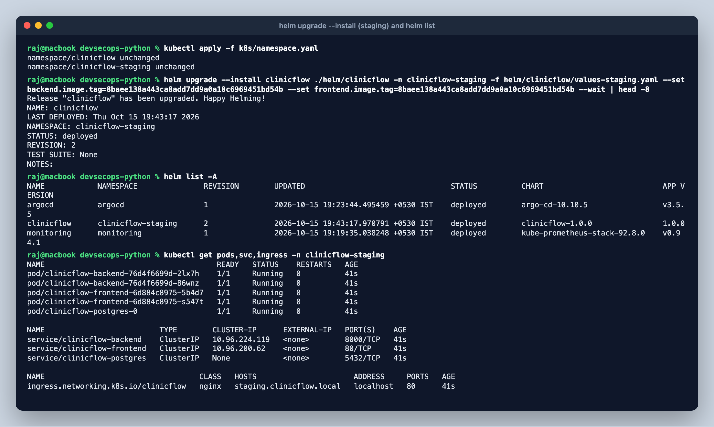

**Production, with GitOps** (Argo CD renders the same chart; nobody runs `kubectl apply`):

```bash
helm upgrade --install argocd argo/argo-cd --version 10.10.5 -n argocd --create-namespace -f gitops/argocd-values.yaml
kubectl apply -f gitops/argocd-application.yaml
```

The chart ([`helm/clinicflow/`](helm/clinicflow/)):

| Object | Configuration |
|---|---|
| backend Deployment | **2 replicas** (HPA 2–6 at 60% CPU); startup, liveness (`/health`) and readiness (`/ready`) probes; config from a ConfigMap, password from a Secret; checksum annotations roll the pods when either changes; `maxUnavailable: 0` |
| frontend Deployment | **2 replicas**; probes on `/healthz`; read-only root FS (nginx renders its config into an `emptyDir`) |
| Services | **ClusterIP** for backend (8000) and frontend (80); headless Service for PostgreSQL |
| PostgreSQL | StatefulSet + 1 Gi PVC, UID 70, `PGDATA` in a subdirectory |
| Ingress | class `nginx`, host `clinicflow.local`: `/` → frontend; `/api`, `/docs`, `/openapi.json` → backend |
| HPA, PDBs | backend 2–6 replicas (+2 pods per 15 s up, 60 s scale-down window); at most one pod per tier evicted at a time |
| Monitoring | ServiceMonitor, PrometheusRule, Grafana dashboard ConfigMap |
| Guard rail | an empty image tag fails rendering: every deploy must name a commit SHA |

`values-dev.yaml` (1 replica, no HPA), `values-staging.yaml` and `values-prod.yaml` (3–10 replicas,
external database through `existingSecret`, no in-cluster PostgreSQL) all lint cleanly in CI.

**Production pods, Services, Ingress, HPA and PDBs**, all Running, with images tagged by commit SHA:

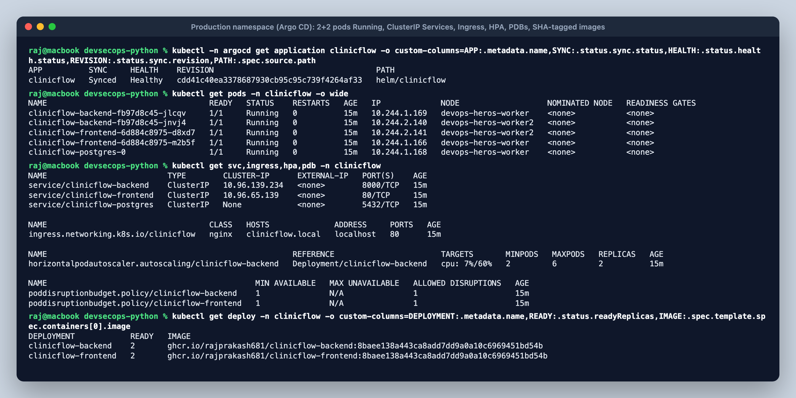

**Argo CD:** the application is Synced and Healthy at the commit the pipeline's bot made
(`gitops: deploy clinicflow 8baee13`):

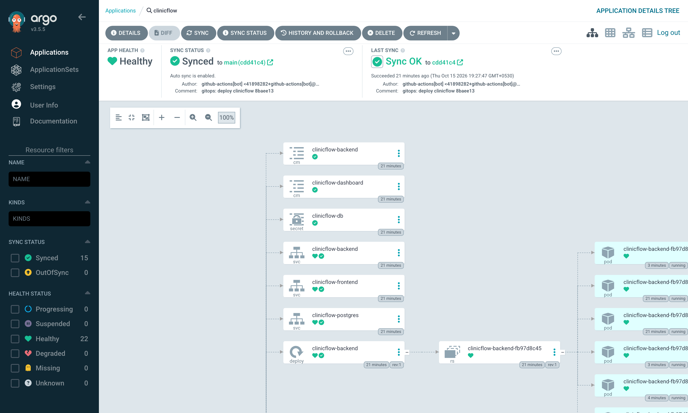

**GitOps flow:** Argo CD's history, newest first. My push `ec4ec2e` (a dashboard change) was
synced as soon as Argo CD saw it. Three minutes later, the pipeline's own commit `1060f80`
switched the images to `ec4ec2e`, and Argo CD rolled the Deployments. Every sync says
*Initiated by: automated sync policy*:

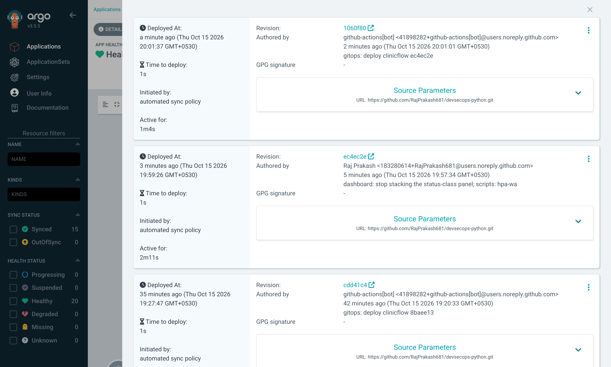

**The application through the Ingress hostname**; the sidebar shows the build (`8baee13`) and the
pod that answered:

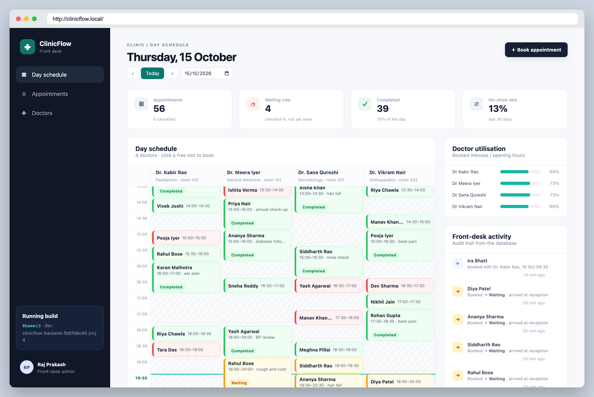

Through the Ingress: free slots, a booking (201), the same slot again (409), the row in the
in-cluster PostgreSQL, and the startup migration log:

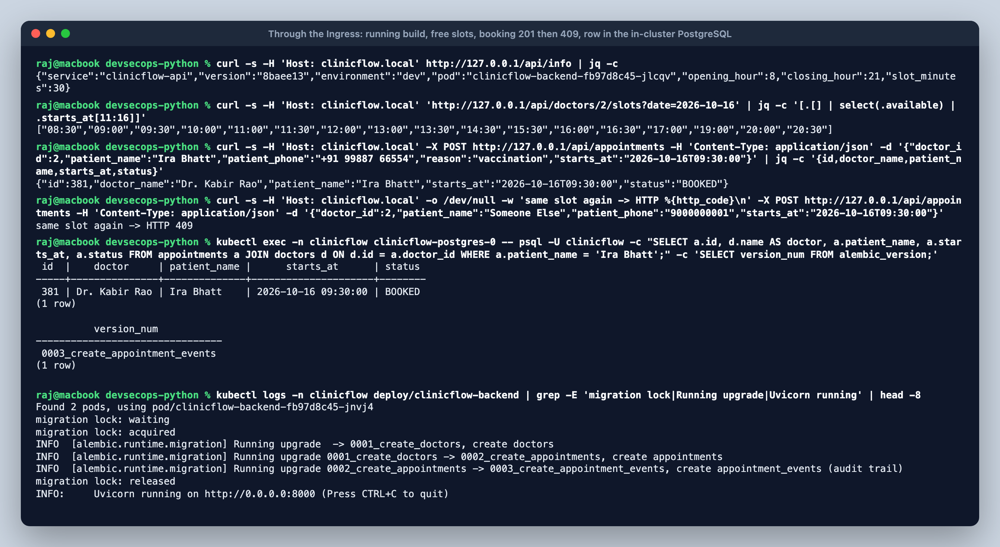

**Migration race test** ([`scripts/migration-race-job.yaml`](scripts/migration-race-job.yaml)).
A Job starts three pods that run `alembic upgrade head` against an empty database at the same
moment. All three asked for the lock within 25 ms of each other. One applied the three
migrations; the other two waited, found the schema current, and exited 0.

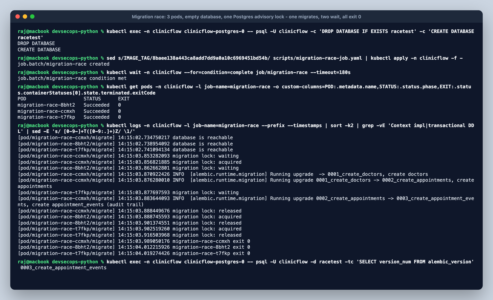

**Autoscaling.** Four minutes of load through the Ingress (16 workers), sampled every 15 s with
[`scripts/hpa-watch.sh`](scripts/hpa-watch.sh). CPU reached about 720% of target and the HPA went
**4 → 6** within 30 s. It was already at 4 because seeding and earlier traffic had scaled it.
When the load stopped, it scaled **back to 2** about 75 s later (60 s stabilisation window). Six
is the configured maximum, so `ClinicFlowAutoscalerAtMax` went pending, as designed
([§14](#14-m9--observability-prometheus--grafana)).

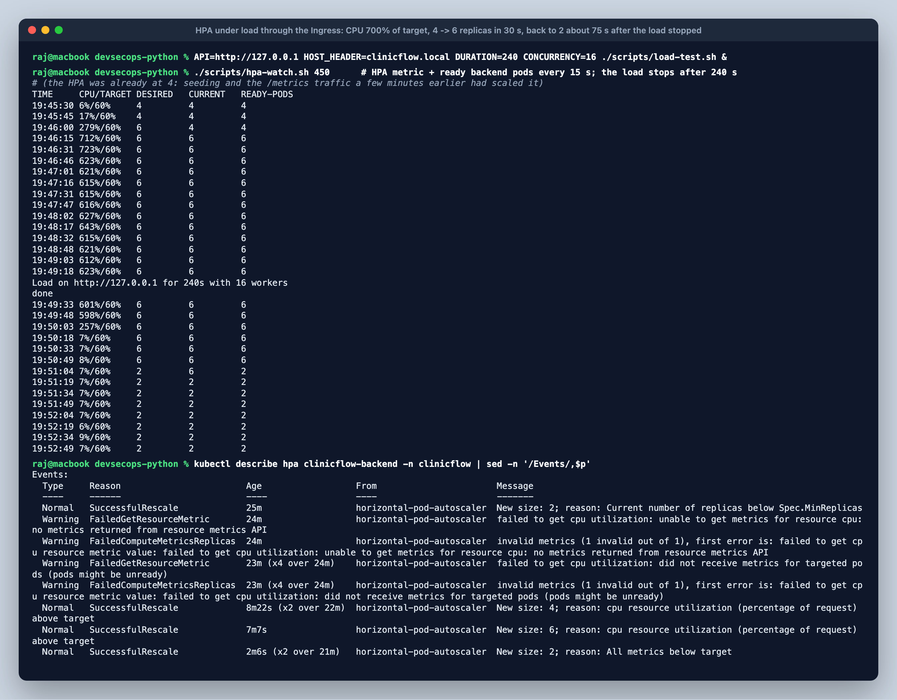

---

## 14. M9 — Observability (Prometheus + Grafana)

Installed with kube-prometheus-stack 92.8.0 and [`monitoring/kube-prometheus-stack-values.yaml`](monitoring/kube-prometheus-stack-values.yaml);
setup steps in [`monitoring/README.md`](monitoring/README.md). The ClinicFlow chart plugs itself
in: nothing is configured by hand.

- **`/metrics`:**
  - Request count and latency per route, with buckets from 5 ms (the defaults start at 100 ms,
    where every request of this API would land in the first bucket).
  - Clinic gauges read from the database at scrape time, so every replica reports the same
    numbers: `clinic_appointments_today{status}`, `clinic_patients_waiting`,
    `clinic_no_show_ratio_30d`, `clinic_doctors_active`.
  - Counters for rejected double bookings and for status changes.

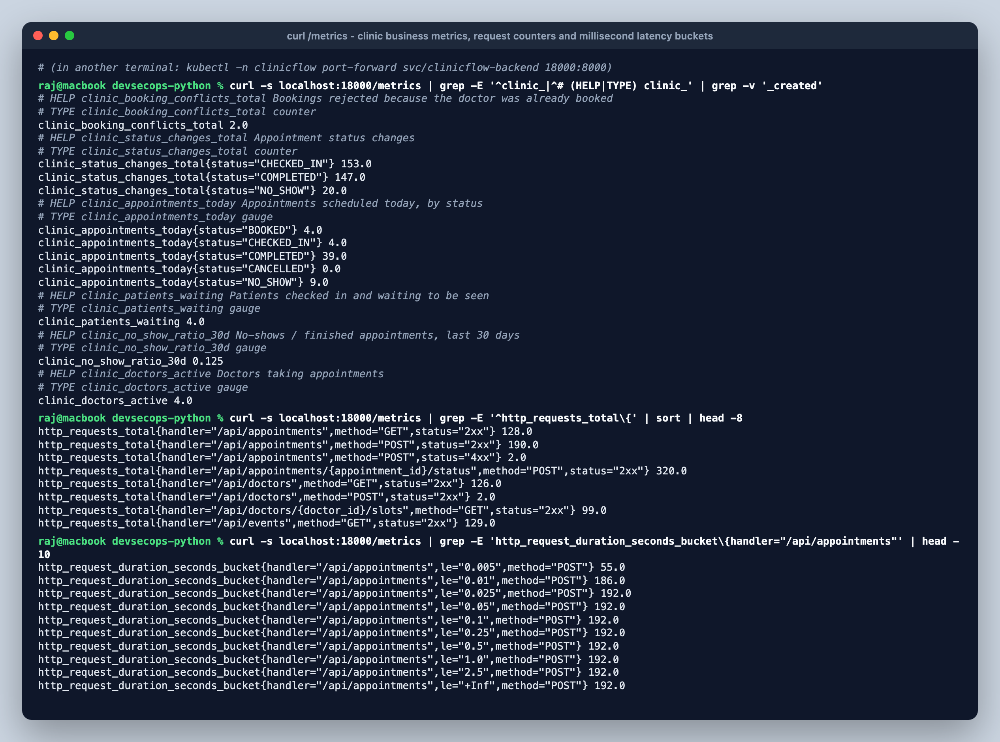

- **Prometheus** scrapes every backend pod through the ServiceMonitor: **6/6 UP**, captured during
  the load test while the HPA was at its maximum.

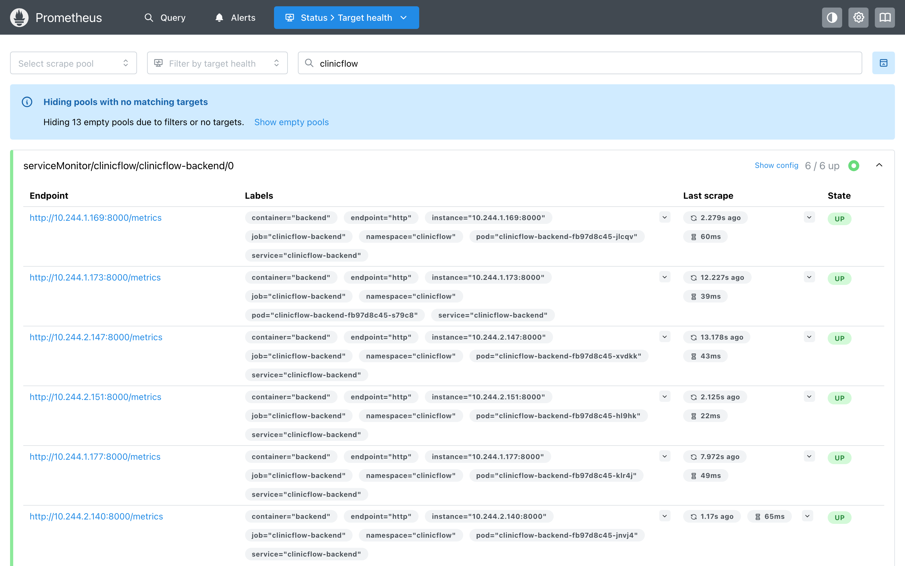

- **7 alert rules:**
  - Availability: backend down, 5xx ratio > 5%, p95 > 500 ms, HPA at max.
  - Clinic: 30-day no-show rate > 20%, waiting room ≥ 8 for 15 min, a burst of double-booking
    attempts (a desk working from a stale view).

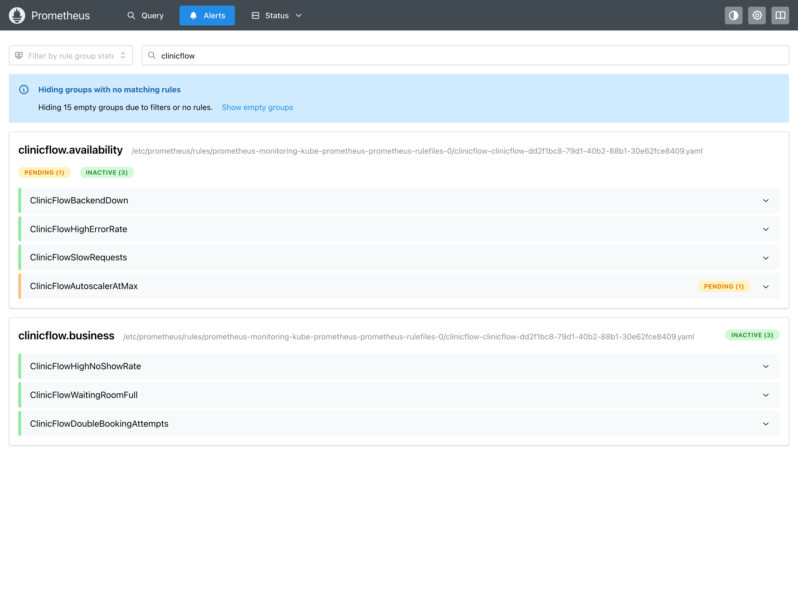

- **Grafana:** the **ClinicFlow** dashboard ships with the chart
  ([`dashboards/clinicflow.json`](helm/clinicflow/dashboards/clinicflow.json), 19 panels) and is
  loaded by Grafana's sidecar. Captured after the load test, it shows the whole cycle: request
  rate per route, status classes, p95 per route, requests per pod as the HPA added pods, replicas
  2 → 6 → 2, CPU and memory per pod, and today's appointments by status.

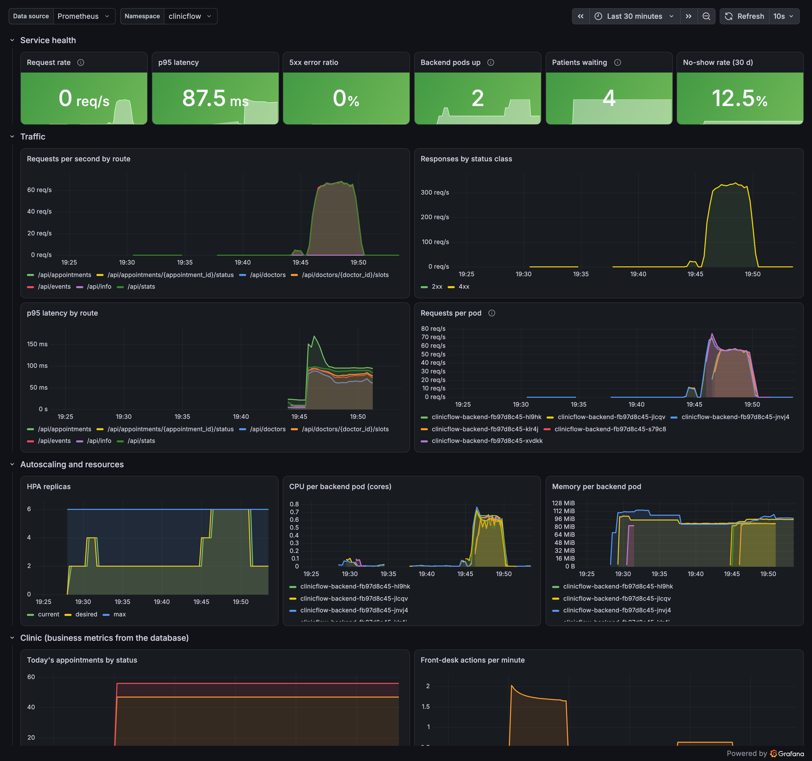

---

## 15. Troubleshooting labs

Three Deployments broken on purpose ([`troubleshooting/`](troubleshooting/)), each diagnosed from
the cluster alone and fixed live:

| Lab | Symptom | Investigation | Root cause | Fix |
|---|---|---|---|---|
| [`lab1-broken-image`](troubleshooting/lab1-broken-image.yaml) | pods `ImagePullBackOff` | `describe pod`, events: *NotFound* | tag typo `1.29-alpnie` | `kubectl set image` → rollout succeeds |
| [`lab2-broken-service`](troubleshooting/lab2-broken-service.yaml) | pods Ready, Service answers nothing (HTTP 000) | empty EndpointSlice; Service selector vs `--show-labels` | selector `app=patient-portl` | patch the selector → 2 endpoints, HTTP 200 |
| [`lab3-broken-probe`](troubleshooting/lab3-broken-probe.yaml) | pods `Running` but `0/1` Ready, no restarts | EndpointSlice `ready=false`; probe port vs container port | readiness probe on 80, nginx listens on 8080 | probe on the named port `http` → Ready, endpoints serve |

| Lab 1 | Lab 2 | Lab 3 |
|---|---|---|
| 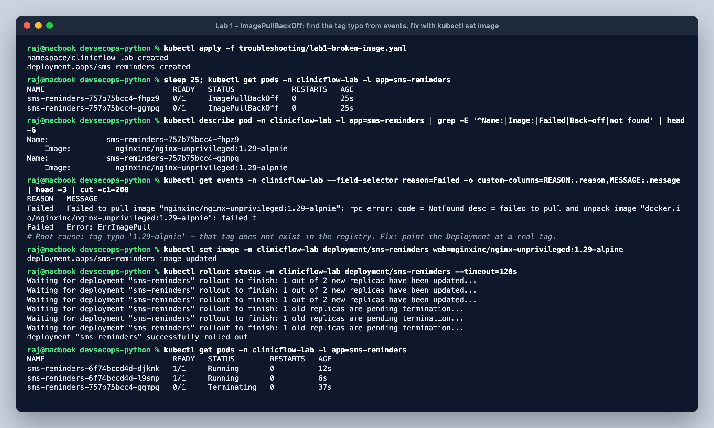 | 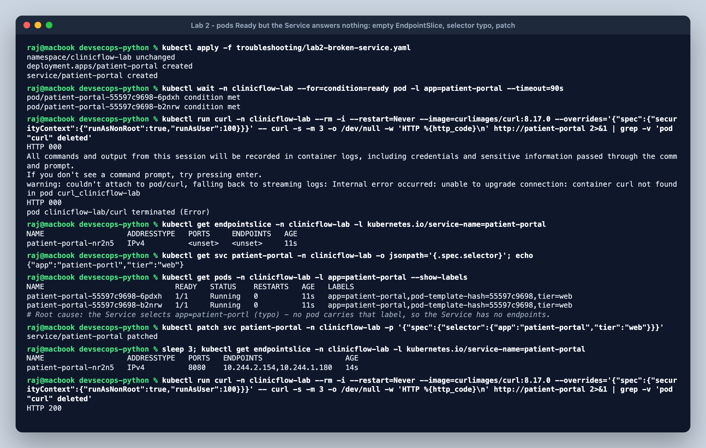 | 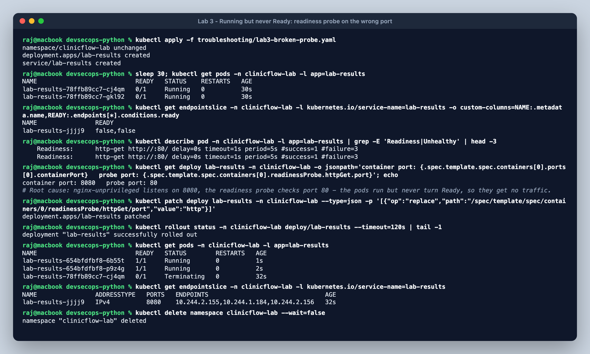 |

---

## 16. Engineering findings

Problems found by running the system, and what I changed:

1. **The Trivy gate blocked the first frontend image** (CVE-2026-4775, [§11](#11-m6--devsecops-trivy)).
   The Dockerfile already ran `apk upgrade`, and the fixed libtiff was already in Alpine's
   repository. The rebuilt image still had 4.7.1 because Docker reused a cached
   `RUN apk upgrade` layer from an earlier build. An upgrade step is only as fresh as its layer
   cache, so the real fix removes the package's reason to exist.
2. **`localhost:3000` was a different app.** Another dev server on my machine listens on `[::1]:3000`,
   and browsers try IPv6 first, so they got that app while `curl -4` reached ClinicFlow. Compose
   publishes on IPv4 and IPv6 alike; the conflict was on the host. I documented it instead of
   changing ports. The screenshot tooling maps `localhost` to 127.0.0.1.
3. **The UI and API disagreed about opening hours.** They were hardcoded in both places; when I
   widened them for the evening OPD, the grid would have kept offering the old slots. The API now
   publishes its hours in `/api/info` and the grid is drawn from them.
4. **`helm list` was empty for production.** Argo CD renders Helm charts itself and creates no
   Helm release, so a GitOps-managed app never appears in `helm list`. Staging is therefore a
   real Helm release, and production stays with Argo CD.
5. **A fresh install starts with one backend pod.** With the HPA owning the replica count, the
   Deployment has no `replicas` field, so it starts at 1 until the HPA sets 2 about 15 s later.
   Argo CD briefly showed *Degraded*. Writing `replicas` into the Deployment would fix the first
   15 s, but every later sync would reset a scaled-up Deployment back to 2. I kept the HPA as the
   only owner and told Argo CD to ignore `/spec/replicas`.
6. **A misleading Grafana panel.** Stacked, the handful of expected 409s (rejected double
   bookings) were drawn on top of the 2xx series and read like hundreds of 4xx per second
   during the load test. That panel is no longer stacked.
7. **The emulator has limits.** moto does not store an EKS cluster's `accessConfig`, so the CLI
   returned `None` for the authentication mode. I left that field out of the evidence rather than
   show a value that only reflects the emulator.

---

## 17. Known issues and limitations

- **No real AWS run.** M7 ran against the moto emulator (§12): no AWS Console screenshots, and the
  application ran on a local kind cluster, not on the EKS cluster the Terraform defines. Running
  it on real AWS needs an account and the commands in §12, about 15 minutes plus `terraform destroy`.
- **No authentication.** ClinicFlow assumes a trusted front-desk network; there are no logins or
  roles. Patient names and phone numbers are personal data, so a real deployment needs auth
  (e.g. OIDC at the Ingress) and TLS first.
- **Single-instance PostgreSQL** in the cluster, with no backups. `values-prod.yaml` expects a
  managed database (Amazon RDS) that this Terraform does not create.
- **GitOps polls.** Argo CD checks GitHub every 60 s; a laptop cluster can't receive a webhook,
  so a deploy takes up to a minute after the promotion commit.
- **One clinic, one time zone** (`CLINIC_TZ`); fixed 30-minute slots and fixed daily hours.
- **The HPA's ceiling is the cluster.** At 6 backend replicas the kind nodes are the limit; on EKS,
  the Cluster Autoscaler or Karpenter would add nodes.
- **Demo values in Git.** The in-cluster database password in `values.yaml` and the Compose default
  are local-only values, documented and allowlisted in Gitleaks; production uses `existingSecret`.

---

## 18. M10 — Presentation and demo

[`demo/`](demo/) contains:

- **[`ClinicFlow-demo.mp4`](demo/ClinicFlow-demo.mp4)**, the presentation video. It starts with the
  slides (what I built, the architecture), then walks through the codebase, triggers a push and
  follows the GitHub Actions run end to end, then shows Terraform (plan/apply output and the
  emulated-AWS inventory), Argo CD syncing the new commit, `kubectl get pods,svc,ingress`, the
  Prometheus targets page and the live Grafana dashboard. It was recorded with Playwright, with
  narration generated by macOS text-to-speech.
- **[`ClinicFlow-presentation.pptx`](demo/ClinicFlow-presentation.pptx)** and
  **[`ClinicFlow-presentation.pdf`](demo/ClinicFlow-presentation.pdf)**, the slide deck: overview,
  stack, architecture, CI/CD, infrastructure, Kubernetes, observability, findings, learnings.

Live demo script:

1. Open `http://clinicflow.local`, book a patient into a free slot, check them in, and complete
   the visit. Show `/docs`.
2. `kubectl exec -n clinicflow clinicflow-postgres-0 -- psql -U clinicflow -c 'TABLE appointment_events'`
3. Change something visible in `frontend/src/`, then `git commit && git push`.
4. Watch the 11 jobs; the new SHA appears in GHCR, and the promote job commits it to `gitops/`.
5. Argo CD syncs within a minute; the sidebar's "Running build" shows the new SHA.
6. `API=http://127.0.0.1 HOST_HEADER=clinicflow.local ./scripts/load-test.sh` and
   `./scripts/hpa-watch.sh`; watch Grafana.
7. Apply `troubleshooting/lab2-broken-service.yaml` and diagnose it live.

---

## 19. Submission checklist

| Requirement | Evidence |
|---|---|
| GitHub repository URL | <https://github.com/RajPrakash681/devsecops-python> |
| Runs via `docker compose up --build` | [§9](#9-m4--docker) |
| ≥ 4 REST endpoints (GET, POST, PUT, DELETE) | 17 endpoints: [§1](#1-what-clinicflow-does); Swagger in [§6](#6-m1--application) |
| Alembic migration files | [`backend/alembic/versions/`](backend/alembic/versions/) (3 migrations) |
| pytest passes, ≥ 5 tests, test DB | 32 cases on SQLite: [§7](#7-m2--testing) |
| backend Dockerfile; frontend multi-stage; non-root | [§9](#9-m4--docker) |
| Workflow on push to `main`; pytest; frontend build; both images; GHCR with SHA tags | [§10](#10-m5--cicd-github-actions) |
| Trivy on both images, fails on HIGH/CRITICAL; CVE explained; no secrets committed | [§11](#11-m6--devsecops-trivy) |
| `terraform plan`, VPC + EKS, `terraform destroy`, `tfvars.example` | [§12](#12-m7--terraform-aws-vpc--eks) (moto emulator, no Console) |
| `k8s/namespace.yaml`, Helm chart, `helm upgrade --install`, 2+2 replicas, ClusterIP, Ingress, pods Running, `helm list` | [§13](#13-m8--kubernetes-helm-and-gitops) |
| `/metrics`, Prometheus targets UP, Grafana with live panels | [§14](#14-m9--observability-prometheus--grafana) |
| README with all technical sections; video and slides in `demo/` | this file; [§18](#18-m10--presentation-and-demo) |
